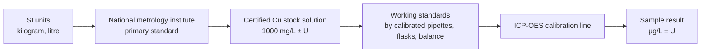
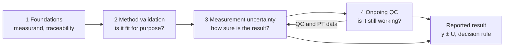

# 1 Foundations

!!! note "Draft"
    First draft, not yet reviewed by a second practitioner. VIM clause numbers
    refer to JCGM 200:2012 and are still to be checked against the current edition.

## The question this chapter answers

**Before we calculate anything: what exactly are we measuring, and what do the
words mean?**

Most arguments about uncertainty budgets are really arguments about vocabulary.
One analyst says "precision" and means repeatability over one sequence; the
assessor hears intermediate precision over six months. This chapter fixes the
words, the measurand and the chain of traceability, so the later chapters can be
about numbers.

The examples follow one fictional method all the way through the handbook:
**copper (Cu) in water by ICP-OES**, reported in µg/L. All data are synthetic
(see `scripts/make_data.py`).

## Why measurement uncertainty matters

A result without its uncertainty cannot be compared with anything: not with a
limit, not with another laboratory, not with last year's result.

Suppose a hypothetical discharge permit sets a limit of 50 µg/L Cu and the lab
reports **48.2 µg/L**. With an expanded uncertainty of 3.4 µg/L (k = 2), the
interval is 44.8 to 51.6 µg/L, and it contains the limit. Whether the sample
"passes" now depends on the decision rule agreed with the customer, not on the
number alone (chapter 4 covers decision rules, ILAC G8 and JCGM 106).

ISO/IEC 17025 makes this explicit:

- **7.6** requires the lab to identify the contributions to measurement
  uncertainty and evaluate it for its tests and calibrations.
- **7.8.3** requires the uncertainty in the test report when it affects the
  validity or application of the result, when the customer asks for it, or when
  it affects conformity to a specification limit.
- **7.1.3** requires the decision rule to be agreed when a statement of
  conformity is requested.

!!! example "From the lab"
    *[To write: one or two short paragraphs from your own experience. For
    example, a result near a limit where the uncertainty changed the decision, or
    a question a customer or assessor asked about it.]*

## Vocabulary (VIM)

The *International Vocabulary of Metrology* (VIM, JCGM 200) is free and is the
reference for every term below. The definitions here are paraphrased; the VIM
clause is given so you can read the exact wording.

### Measurand, measured quantity value and true value

- **Measurand** (VIM 2.3): the quantity *intended* to be measured. Not the
  instrument reading, and not "copper": a specific, well-defined quantity (see
  [Defining the measurand](#defining-the-measurand)).
- **Measured quantity value** (VIM 2.10): the value the lab obtains, here
  48.2 µg/L.
- **True quantity value** (VIM 2.11): the value consistent with the definition
  of the measurand. It is unknowable in practice; what a lab can know is a
  *reference* value, such as a certified value or an assigned PT value, which has
  its own uncertainty.

### Error, bias and precision

**Measurement error** (VIM 2.16) is the measured value minus a reference value.
It has two parts that behave differently:

- **Systematic error** (VIM 2.17) stays constant or changes predictably over
  replicate measurements. Its estimate is the **bias** (VIM 2.18).
- **Random error** (VIM 2.19) varies unpredictably. Its spread is described by
  **precision** (VIM 2.15), usually as a standard deviation.

For *n* results \(x_i\) on a material with reference value \(x_\text{ref}\):

$$
b = \bar{x} - x_\text{ref}, \qquad
s = \sqrt{\frac{1}{n-1}\sum_{i=1}^{n}\left(x_i - \bar{x}\right)^2}
$$

The synthetic control sample (target 50.0 µg/L, 60 runs) shows both:

```python
import pandas as pd

qc = pd.read_csv("data/synthetic/qc.csv")
x = qc["cu_ug_L"]
bias = x.mean() - qc["target_ug_L"].iloc[0]
s = x.std(ddof=1)
print(f"mean {x.mean():.2f}, bias {bias:+.2f} ug/L, s {s:.2f} ug/L, RSD {100 * s / x.mean():.1f} %")
# mean 50.55, bias +0.55 ug/L, s 1.36 ug/L, RSD 2.7 %
```

Two cautions that the rest of the handbook builds on:

1. The bias here is relative to the control's *target*, which is itself an
   estimate. A bias against a CRM or a PT assigned value tells you more (chapter 2
   on trueness, chapter 3 on the Nordtest bias component).
2. A bias of +0.55 µg/L from 60 runs has its own uncertainty
   (\(s/\sqrt{n}\) ≈ 0.18 µg/L). Whether to correct for it, or include it in the
   uncertainty, is a decision the lab documents.

### Trueness and accuracy

- **Trueness** (VIM 2.14): closeness of the *average* of many results to a
  reference value. It is expressed by bias, so it is the inverse of systematic
  error.
- **Accuracy** (VIM 2.13): closeness of a *single* result to the true value. It
  depends on both trueness and precision, which is why VIM treats it as a
  qualitative concept: you cannot give "accuracy" one number.

A method can be precise and still wrong (small *s*, large *b*), or right on
average and too noisy to be useful (small *b*, large *s*). Validation has to look
at both.

### Repeatability, intermediate precision and reproducibility

Precision is meaningless until you say *under which conditions* it was measured.
The three standard conditions differ in what is allowed to change:

| Condition | VIM | What stays the same | What varies | Typical use |
| --- | --- | --- | --- | --- |
| Repeatability | 2.20, 2.21 | Procedure, analyst, instrument, location, short period | Only the replicate | Duplicate limits, LOD |
| Intermediate precision | 2.22, 2.23 | Procedure and laboratory | Days, analysts, calibrations, reagent lots, over a longer period | Within-lab reproducibility, *u*(R<sub>w</sub>) in Nordtest |
| Reproducibility | 2.24, 2.25 | Procedure | Laboratories, analysts, instruments | Interlaboratory studies, PT |

Intermediate precision is the one a routine lab should care about most: it is
what a customer experiences when they send the same sample on two different
days. The control-sample SD above (1.36 µg/L over three months of runs) is an
intermediate-precision estimate; a duplicate pair measured in the same run would
usually show less scatter.

!!! example "From the lab"
    *[To write: where you have seen repeatability reported as if it were the
    method's precision, and what changed when intermediate precision was used.]*

### Measurement uncertainty

**Measurement uncertainty** (VIM 2.26) is a non-negative parameter that
characterises the dispersion of the values that could reasonably be attributed to
the measurand, based on the information used.

Three points that are often confused:

- **Uncertainty is not error.** Error is a single (unknown) difference from the
  true value. Uncertainty describes how far the true value could reasonably be,
  given everything the lab knows.
- **Standard and expanded uncertainty.** The combined standard uncertainty
  \(u_c\) (VIM 2.31) is a standard deviation. The expanded uncertainty
  \(U = k\,u_c\) (VIM 2.35) defines an interval expected to contain a large
  fraction of the values, typically about 95 % with coverage factor \(k = 2\).
- **Type A and Type B** (VIM 2.28, 2.29) describe *how* a component was
  evaluated (statistics on repeated data, or other information such as a
  certificate), not whether it is "random" or "systematic".

The result is reported as:

$$
y \pm U \quad (k = 2), \qquad \text{e.g. } 48.2 \pm 3.4~\mu\text{g/L}
$$

Chapter 3 builds \(u_c\) two ways: bottom-up from a model of the measurement
(GUM) and top-down from QC and PT data (Nordtest TR 537).

## Defining the measurand

The measurand is defined before the method is chosen, and it is defined
completely enough that the result answers the customer's question.

"Copper in the water sample" is not a measurand. Each of these is a different
one, and they can give different numbers for the same bottle:

| Measurand | What it includes |
| --- | --- |
| Dissolved Cu | Cu passing a 0.45 µm filter, filtered on site, then acidified |
| Total recoverable Cu | Cu released by a specified acid digestion of the unfiltered sample |
| Total Cu | All Cu present, including mineral particles not released by that digestion |

For this handbook's running example the measurand is: **mass concentration of
dissolved copper, in µg/L, in the sample as received, filtered through 0.45 µm
and acidified to pH < 2.**

A loose definition does not disappear; it becomes **definitional uncertainty**
(VIM 2.27), the minimum uncertainty any measurement of that measurand can have.
If the customer wanted "total" and the lab measured "dissolved", no amount of
care in the budget fixes it.

!!! tip "Checklist for a measurand definition"
    - The quantity (mass concentration, mass fraction, amount fraction ...)
    - The analyte and its form (dissolved, total, a specific species)
    - The matrix and the sample state (as received, dry basis, after a stated
      preparation)
    - The unit, and any reference conditions (temperature, O₂ correction for
      emissions)

## Metrological traceability

**Metrological traceability** (VIM 2.41) is the property of a result that relates
it to a stated reference, usually an SI unit, through a documented, unbroken chain
of calibrations, *each contributing to the measurement uncertainty*.

The last part matters: a chain without uncertainties at each link is not
traceability. For the Cu example:



Each arrow is a step with its own uncertainty: the CRM certificate, the
volumetric and weighing steps of the dilutions, and the calibration fit.
ISO/IEC 17025 **6.5** sets the requirement; the ILAC P10 policy says which
calibration and reference-material providers satisfy it.

Two practical consequences:

- A CRM certificate with no uncertainty, or a "certificate of analysis" from a
  supplier that is not an accredited reference material producer, weakens the
  chain. Check what your stock solutions actually carry.
- Traceability of the *calibration* is not the whole story. Sample preparation
  (digestion, filtration) is part of the method, and its effect reaches the
  result through trueness, which is why chapter 2 tests recovery and CRMs.

## Validation and verification

The two words are close in VIM and often mixed up in practice:

- **Verification** (VIM 2.44): objective evidence that an item meets specified
  requirements.
- **Validation** (VIM 2.45): verification where the requirements are adequate for
  an *intended use*.

In a laboratory this becomes a practical split:

| | Verification | Validation |
| --- | --- | --- |
| When | Adopting a standard method as published | Lab-developed or non-standard methods, or a standard method used outside its scope or modified |
| ISO/IEC 17025 | 7.2.1.5 | 7.2.2 |
| The question | Can *we* achieve the published performance? | Is the method fit for *this* purpose at all? |
| Typical evidence | Precision and trueness checked against the standard's figures, LOD in our matrix | Full set: selectivity, working range, linearity, LOD/LOQ, trueness, precision, robustness, uncertainty |

Both end in the same place: documented performance characteristics, compared with
requirements that were set *before* the data were collected. Chapter 2 works
through each characteristic for the Cu method.

!!! example "From the lab"
    *[To write: how the accreditation work you took part in handled verification
    of standard methods versus validation of in-house ones, and what an assessor
    asked to see.]*

## From validation to the reported result: how the chapters fit together

The chapters follow the life of one method:



The loop between chapters 3 and 4 is deliberate. Validation data give the first
uncertainty estimate; routine QC and PT results then update it. That is the
Nordtest top-down approach, and the reason the synthetic QC and PT data share the
same bias and precision.

Chapter 5 runs the whole path on two worked examples, and chapter 6 collects the
tools and templates.

## References

- JCGM 200:2012, *International vocabulary of metrology (VIM)*, 3rd edition.
- JCGM 100:2008, *Guide to the expression of uncertainty in measurement (GUM)*.
- ISO/IEC 17025:2017, clauses 6.5, 7.1.3, 7.2, 7.6, 7.8.3.
- Eurachem, *The Fitness for Purpose of Analytical Methods*, 2nd edition (2014).
- ILAC P10, *ILAC Policy on Metrological Traceability of Measurement Results*.
- ILAC G8, *Guidelines on Decision Rules and Statements of Conformity*.

Editions and links are tracked on the [References](../references.md) page.
